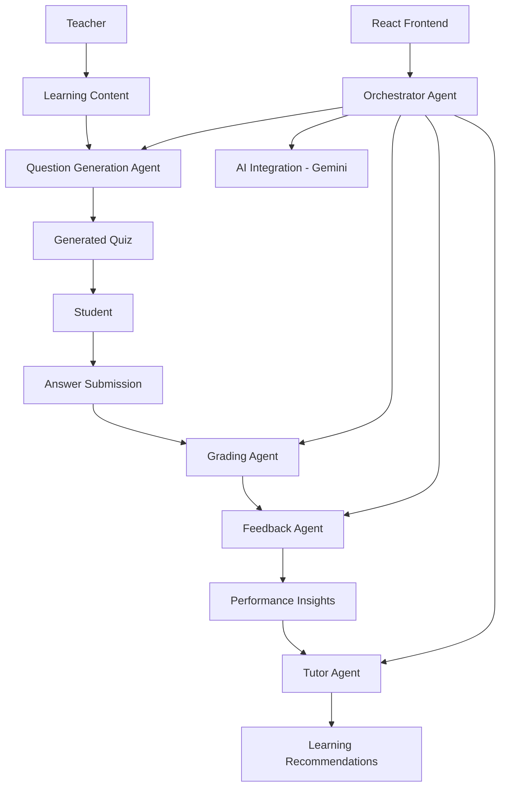

# 🎓 EduTutor Agent (QuizMind)

### AI-Powered Quiz Generation, Grading & Feedback Prototype

EduTutor Agent (QuizMind) is a basic prototype exploring how AI agents can automate quiz generation, student answer evaluation, and personalized learning feedback.

The project demonstrates a multi-agent approach to simplifying assessment workflows for teachers and students.

## ✨ Key Features

- **AI Question Generation:** Generates quiz questions from learning content.
- **Automated Grading:** Evaluates student answers using AI-assisted assessment.
- **AI Feedback:** Provides explanations and feedback on student responses.
- **Personalized Learning:** Suggests areas for improvement.
- **Role-Based Experience:** Designed for students, teachers, and administrators.
- **Multi-Agent Workflow:** Separates question generation, grading, feedback, and tutoring responsibilities.

## 🛠️ Tech Stack

| Category | Technologies |
|---|---|
| Frontend | React 18, TypeScript |
| Styling | Tailwind CSS |
| Build Tool | Vite |
| AI Integration | Google Gemini API |
| Icons | Lucide React |
| PDF Generation | jsPDF, jsPDF-AutoTable |

## 🏗️ System Architecture



## 🔄 Basic Workflow

1. Teacher provides learning content.
2. Question Generation Agent prepares quiz questions.
3. Student attempts the generated quiz.
4. Grading Agent evaluates the answers.
5. Feedback Agent generates explanations and feedback.
6. Tutor Agent suggests learning improvements.

## 📁 Project Structure

```text
EduTutor_prototype/
│
├── components/
├── context/
├── hooks/
├── services/
├── App.tsx
├── index.tsx
├── types.ts
├── metadata.json
├── index.html
├── package.json
├── tsconfig.json
├── vite.config.ts
├── presentation.md
└── README.md
```

## ⚙️ Getting Started

### Prerequisites

- Node.js
- npm
- Google Gemini API key

### Clone Repository

```bash
git clone https://github.com/Chethan13032005/EduTutor_prototype.git

cd EduTutor_prototype
```

### Install Dependencies

```bash
npm install
```

### Configure Environment

Configure your Gemini API key according to the application's Vite configuration and Gemini service implementation.

Do not commit API credentials to GitHub.

### Run Development Server

```bash
npm run dev
```

### Build for Production

```bash
npm run build
```

## 📌 Scope & Limitations

- This is an experimental prototype.
- Focuses on demonstrating an AI-assisted assessment workflow.
- Uses predefined AI-agent responsibilities.
- Not designed as a production-ready educational platform.
- Backend persistence and production deployment are outside the scope of the current repository description.

## 🚀 Future Scope

- Implement persistent student performance tracking.
- Expand agent coordination and task management.
- Improve grading accuracy and feedback quality.
- Introduce comprehensive testing.
- Develop a dedicated backend and database integration.

## 👨‍💻 Project Information

**Project:** EduTutor Agent (QuizMind)

**Type:** AI/Full-Stack Prototype

**Focus:** Automated Assessment & Personalized Learning

**Repository:** https://github.com/Chethan13032005/EduTutor_prototype
